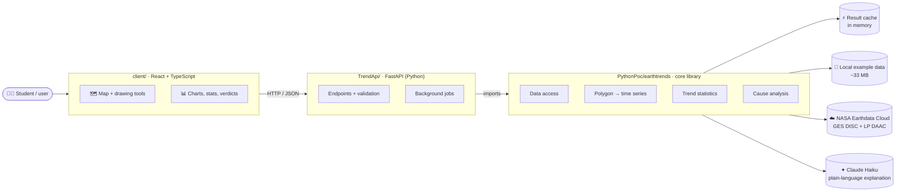
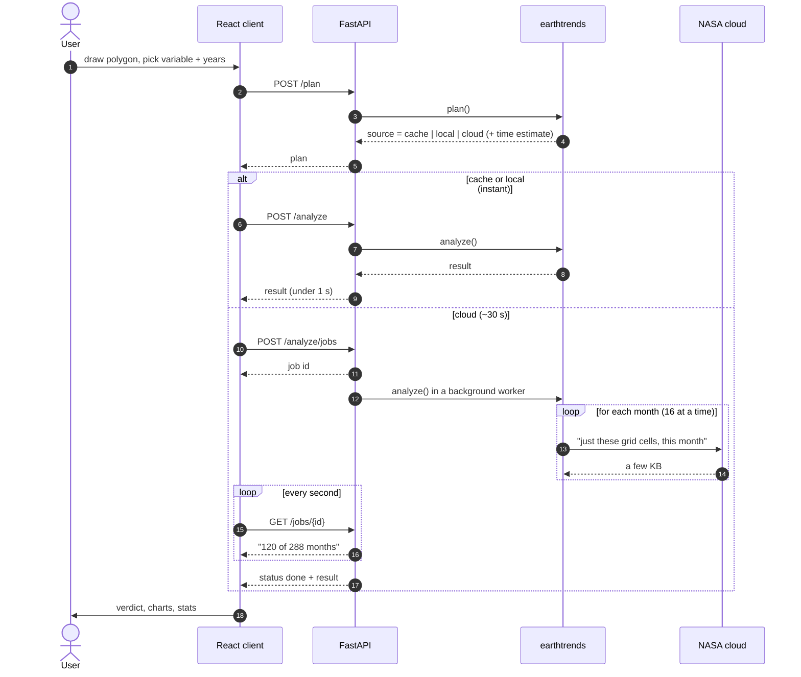
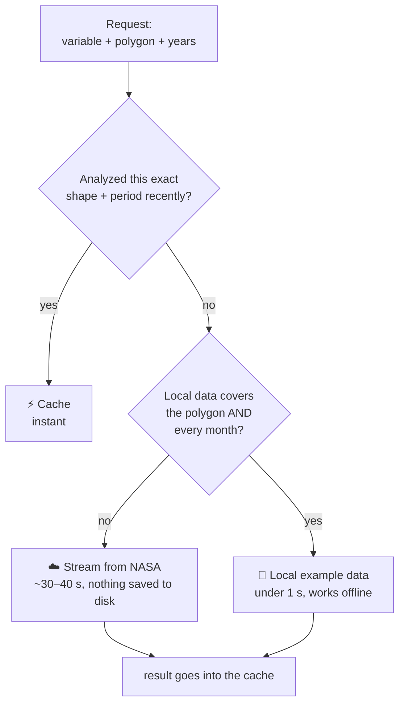
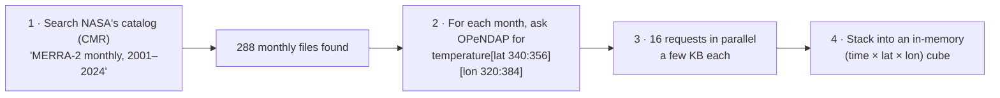
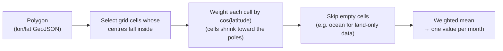
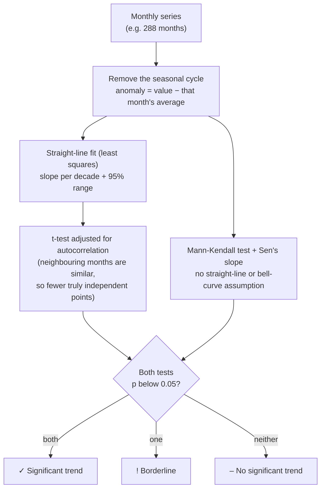
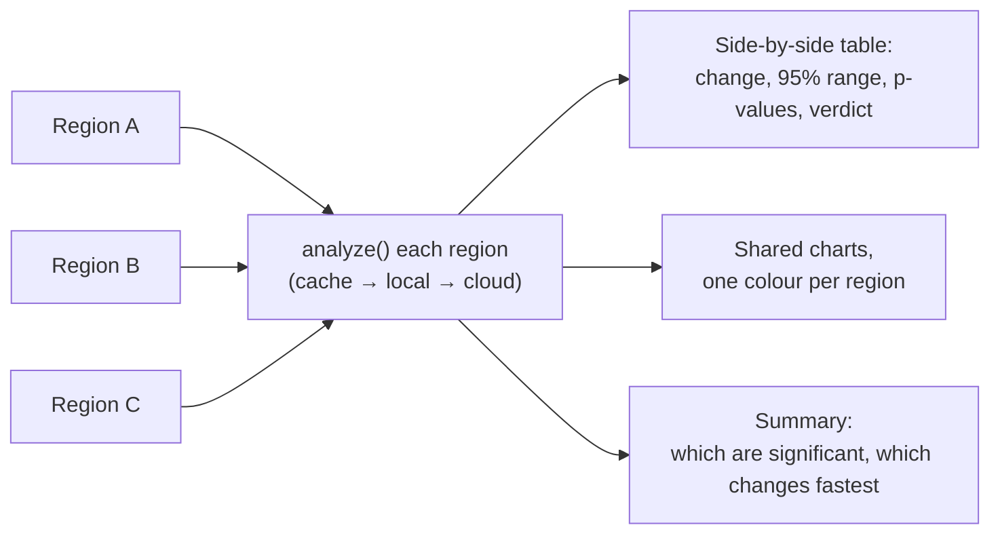
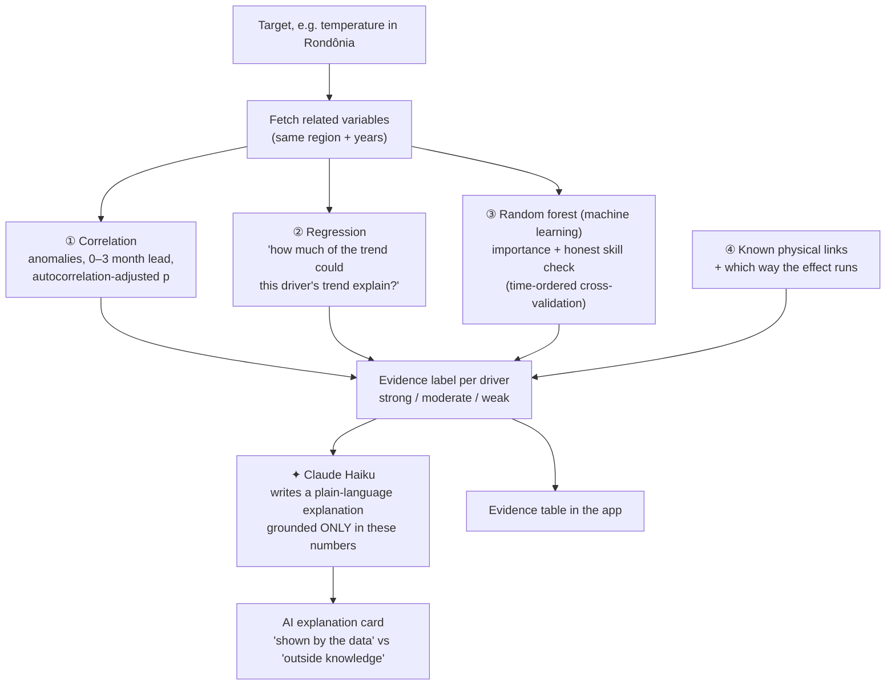
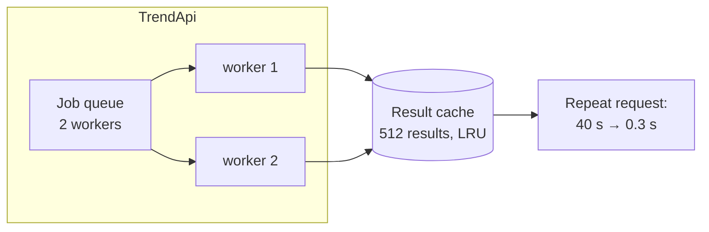
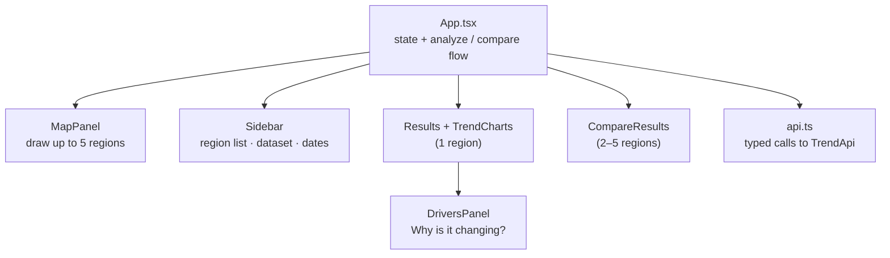

# Trend Detective: Architecture

> **Draw a region on a map → pick a NASA Earth-science variable → find out whether it's
> really changing, how fast, whether that change is statistically significant, and what
> might be causing it.**

Trend Detective is my response to the NASA Space Apps challenge on finding and analyzing
trends in Earth-science data. This document explains how the pieces fit together, from
the map in the browser down to the bytes streamed from NASA's cloud.

**Contents**

1. [The big picture](#1-the-big-picture)
2. [Repository layout](#2-repository-layout)
3. [The life of one analysis](#3-the-life-of-one-analysis)
4. [Where the data comes from](#4-where-the-data-comes-from)
5. [From a polygon to a time series](#5-from-a-polygon-to-a-time-series)
6. [Is the trend real? The statistics](#6-is-the-trend-real-the-statistics)
7. [Comparing regions](#7-comparing-regions)
8. [Why is it changing? Cause analysis + AI](#8-why-is-it-changing-cause-analysis--ai)
9. [Speed: caching and background jobs](#9-speed-caching-and-background-jobs)
10. [The web app](#10-the-web-app)
11. [API reference (summary)](#11-api-reference-summary)
12. [Credentials and security](#12-credentials-and-security)
13. [How I know it's right](#13-how-i-know-its-right)
14. [Known limits and next steps](#14-known-limits-and-next-steps)
15. [Running it locally](#15-running-it-locally)

---

## 1. The big picture

Three parts, each with one job:



| Part | Folder | Job | Knows nothing about… |
|---|---|---|---|
| **Client** | `client/` | Map, drawing, forms, charts. Shows results; does no science. | NASA, statistics |
| **API** | `TrendApi/` | Validates requests, picks the data source, runs slow work in the background, returns JSON. | How the science works |
| **Core library** | `PythonPoc/earthtrends/` | All the science: getting data, averaging over the polygon, trend tests, cause analysis. Also has a command-line interface. | The web |

Keeping the science in a plain Python library means it can be tested on its own, used from
the command line, and called by the API without any copy-pasted code.

---

## 2. Repository layout

```text
Trend-Detective/
├── docs/
│   ├── ARCHITECTURE.md        ← you are here
│   └── PRESENTATION.md        talking points, demo script, schedule
│
├── PythonPoc/                 CORE LIBRARY + command line  (package: earthtrends)
│   ├── earthtrends/
│   │   ├── catalog.py         the 15 variables: NASA dataset, units, plain-language definition
│   │   ├── cloud.py           streams just the polygon's area from NASA's cloud (in memory)
│   │   ├── local.py           finds locally stored data that covers a request
│   │   ├── data.py            NASA login, optional whole-world downloads, date parsing
│   │   ├── region.py          polygon → one area-weighted value per month
│   │   ├── stats.py           seasonal removal, t-test, Mann-Kendall, verdict
│   │   ├── analyze.py         ties it together: plan(), analyze(), compare()
│   │   ├── cache.py           in-memory result cache
│   │   ├── drivers.py         cause analysis: correlation, regression, random forest
│   │   ├── narrative.py       Claude writes the plain-language explanation
│   │   └── __main__.py        CLI: list / analyze / prepare-examples / fetch
│   ├── examples/              demo regions as GeoJSON (Barents Sea, Lake Mead, Rondônia)
│   ├── data/                  (git-ignored) local example data, grids, optional downloads
│   └── tests/                 21 tests, synthetic data, no network needed
│
├── TrendApi/                  WEB API (FastAPI)
│   ├── app/main.py            endpoints
│   ├── app/jobs.py            background jobs with progress
│   ├── .env.example           template for the Anthropic API key
│   ├── samples/               request bodies for Postman / curl
│   └── tests/                 14 tests, fake NASA + fake Claude
│
└── client/                    WEB APP (Vite + React + TypeScript)
    └── src/
        ├── App.tsx            page layout and the analyze / compare flow
        ├── api.ts             typed client for every API call
        ├── regions.ts         region letters A–E and their colours
        └── components/
            ├── MapPanel.tsx         Leaflet map + Geoman drawing tools
            ├── Results.tsx          single-region verdict + stat tiles
            ├── TrendCharts.tsx      raw-values chart + anomaly/trend-line chart
            ├── CompareResults.tsx   2–5 regions side by side
            └── DriversPanel.tsx     "Why is it changing?" evidence + AI explanation
```

---

## 3. The life of one analysis

What happens when someone draws a box and clicks **Analyze trend**:



The same `analyze()` function runs either way. Only the source of the numbers changes.

---

## 4. Where the data comes from

### Three sources, checked in order



- **Cache:** recent results, held in memory.
- **Local:** small clipped copies of the three demo regions (`prepare-examples`, ~33 MB),
  so the presentation works with no internet.
- **Cloud:** everything else. Nothing is written to disk, so a thousand users can't
  fill the server's storage.

### How cloud streaming works

NASA hosts these datasets in its cloud and runs an **OPeNDAP** service that can cut a
region out of a file *before* sending it. Instead of downloading a 61 MB global file per
month, I ask for only the grid cells around the polygon:



|  | Whole-file download | My cloud streaming |
|---|---|---|
| Data moved for 24 years of temperature | ~17 GB | ~10 MB |
| Disk used | ~17 GB | 0 |
| Time | hours | ~30 s |
| Values | identical | identical (verified, difference 0.0) |

### The variables

| Group | Variable | NASA dataset | Kind | Grid |
|---|---|---|---|---|
| Water | Precipitation | **GPM IMERG** monthly | satellite | 0.1° |
| Water | Soil moisture (top 10 cm) | **GLDAS** Noah 2.1 | land model | 0.25° |
| Water | Root-zone soil moisture | GLDAS | land model | 0.25° |
| Water | Evapotranspiration | GLDAS | land model | 0.25° |
| Water | Runoff (surface + groundwater) | GLDAS | land model | 0.25° |
| Water | Snow water equivalent | GLDAS | land model | 0.25° |
| Temperature | Air temperature (2 m) | **MERRA-2** | reanalysis | 0.5° × 0.625° |
| Temperature | Land surface temperature | GLDAS | land model | 0.25° |
| Temperature | Surface air temperature | **AIRS** (Aqua) AIRS3STM v7, day + night | satellite | 1° |
| Vegetation | Greenness (NDVI) | **MODIS** Terra MOD13C2 | satellite | 0.05° |
| Atmosphere | Humidity (2 m) | MERRA-2 | reanalysis | 0.5° × 0.625° |
| Atmosphere | Sea-level pressure | MERRA-2 | reanalysis | 0.5° × 0.625° |
| Atmosphere | Total water vapor | AIRS | satellite | 1° |
| Air quality | Lower-atmosphere ozone (smog) | **OMI**/MLS (Aura) monthly, ~60°S–60°N | satellite | 1° |
| Greenhouse gases | Carbon dioxide (column average, XCO₂), **2015–2022 only** | **OCO-2** blended into the GEOS model | satellite + model | 0.5° × 0.625° |

**All six instruments and models named in the challenge are in:** MODIS, OMI, AIRS, GPM,
MERRA-2 and GLDAS, plus NASA's dedicated carbon-dioxide satellite, OCO-2. Each variable lives in `catalog.py` with its units conversion, a
definition written for students, and the variables it's physically linked to.

Each data centre stores files a little differently, and the catalog records those quirks
so the rest of the code doesn't have to:

| Quirk | Example | Handled by |
|---|---|---|
| Value is the **sum** of two file variables | GLDAS runoff = surface + groundwater | `components` |
| Value is the **mean** of two passes, ignoring a missing one | AIRS day + night | `combine="mean"` |
| Variables in nested groups, 2-D coordinate grids | AIRS, MODIS (HDF4) | group paths, `coords_2d` |
| Scale factor means *divide*, not multiply | MODIS NDVI | `manual_scaling` |
| Dates as day-of-year or with dots | `MOD13C2.A2010182`, `AIRS.2003.12.01` | `data.month_from_filename_str` |
| Whole record in one small file, no cut-out service | OMI/MLS ozone (10 MB, 2004–2024) | `single_file`: downloaded once, read locally |
| Record that has ended | OCO-2 CO₂ stops in 2022-02 | `last_month`: requests are trimmed to the months that exist |

---

## 5. From a polygon to a time series

A dataset is a grid of cells covering the globe. To get **one number per month** for a
drawn region:



- If a polygon is smaller than one grid cell, the nearest cell is used.
- Only the cells around the polygon are ever read: from NASA (cloud) or from disk (local).
- Code: `earthtrends/region.py`.

---

## 6. Is the trend real? The statistics



Why each step matters:

| Step | Without it… |
|---|---|
| Remove the seasonal cycle | Summer vs winter swamps any long-term change |
| Autocorrelation adjustment | The plain t-test is over-confident: it can call noise "significant" (e.g. naive p = 0.0000007 vs adjusted p = 0.005 for the Barents Sea) |
| A second, independent test (Mann-Kendall) | One method's assumptions (straight line, normal noise) could mislead |
| "Both must agree" rule | I'd over-claim; borderline results are labeled as such |

The output also includes the total change, the confidence interval, a plain-English
verdict and the data behind every chart. Code: `earthtrends/stats.py`.

---

## 7. Comparing regions

Up to **5 regions**, the **same variable and period**, side by side, which matches the
challenge's point that one variable can move differently in different places.



- Each region keeps a fixed letter and colour (A–E) on the map, in the charts and in the
  table. The palette was checked for colour-blind safety.
- A region that fails (for example ocean for soil moisture) shows its error and doesn't
  stop the rest.

---

## 8. Why is it changing? Cause analysis + AI

For one region, the target variable is compared with the variables it's physically linked
to (for example temperature with soil moisture, rain, evapotranspiration and vegetation).



Design choices that keep this honest:

- **Statistics first, AI second.** The model explains numbers I computed; it doesn't
  generate the analysis. With no API key, the evidence still appears.
- **Direction matters.** Correlation can't say what causes what, so each pair of variables
  carries a known physical mechanism (rain drives soil moisture, not the reverse).
- **The ML model reports its own skill.** If the random forest can't predict unseen years,
  the app says its importance scores are unreliable.
- **Explicit caveats** are returned with every result: association ≠ cause, unmeasured
  factors (land use, sea ice…), shared inputs between model datasets.
- **Structured output:** Claude must return a fixed JSON shape (headline, causes with
  confidence and a "shown by data" flag, caveats, next steps), so the UI never parses
  free text.

Example (real data): Rondônia's warming (+0.81 °C/decade) is linked most strongly to
**drying soil** (r = −0.67) and **declining vegetation** (MODIS NDVI, r = −0.53). That's
consistent with deforestation reducing evaporative cooling.

Code: `earthtrends/drivers.py` (statistics) and `earthtrends/narrative.py` (Claude).

---

## 9. Speed: caching and background jobs



- **Result cache** (`cache.py`): keyed by variable + polygon shape (snapped to ~10 m) +
  period. In memory, at most 512 entries; the least recently used is dropped first.
- **AI explanation cache:** identical evidence → reuse the explanation (no second API call).
- **Background jobs** (`TrendApi/app/jobs.py`): cloud analyses run in a worker; the client
  polls `/jobs/{id}` once a second to show "120 of 288 months".

---

## 10. The web app



- **Map:** Leaflet with OpenStreetMap tiles. Geoman supplies the polygon and rectangle tools.
- **Charts:** Recharts. There's never a dual axis; every chart has a legend and a data-table view.
- **Light and dark themes** follow the system setting.

---

## 11. API reference (summary)

Full details, with request and response examples, are in [`TrendApi/README.md`](../TrendApi/README.md).
Interactive docs run at `http://127.0.0.1:8000/docs`.

| Method | Path | Purpose |
|---|---|---|
| GET | `/health` | Status, cloud access, AI enabled, cache stats |
| GET | `/variables` · `/variables/{key}` | Variables with definitions and what's stored locally |
| GET | `/examples` · `/examples/{name}` | Demo regions (GeoJSON) |
| POST | `/plan` | Where would the data come from, and how long would it take? |
| POST | `/analyze` · `/analyze/jobs` | One region: series + trend statistics |
| POST | `/compare/plan` · `/compare` · `/compare/jobs` | 2–5 regions side by side |
| POST | `/drivers` · `/drivers/jobs` | Cause analysis + AI explanation |
| GET | `/jobs/{id}` | Progress and result of a background job |
| POST | `/cache/clear` | Empty the result cache |

---

## 12. Credentials and security

| Secret | Used for | Where it lives | Never… |
|---|---|---|---|
| NASA Earthdata login | Streaming from NASA's cloud | `~/_netrc` or the `EARTHDATA_TOKEN` env var | Sent to the browser |
| Anthropic API key | AI explanations | `TrendApi/.env` (git-ignored) | Committed or sent to the browser |

- **CORS:** only the React dev server's address may call the API from a browser.
- **No user accounts or rate limiting yet.** That's fine for a laptop demo; it's needed
  before any public deployment.

---

## 13. How I know it's right

| Check | Result |
|---|---|
| Automated tests (synthetic data with a planted, known trend) | 21 core + 14 API passing |
| OCO-2 CO₂ in three very different regions | +24.7 to +25.0 ppm/decade everywhere (a well-mixed gas), ~407 ppm average, as in global records |
| AIRS satellite vs MERRA-2 model temperature, 2003–2024 | Month-to-month r = 0.88–0.997 in all three demo regions |
| OMI/MLS ozone values | Typical 20–40 Dobson units, as expected for the lower atmosphere |
| Cloud streaming vs full-file download, same region and months | Identical (max difference 0.0) |
| Runoff units: water balance (rain − evaporation = runoff) | Closes at 1.02 for Rondônia |
| MODIS dates (day-of-year file names) | Greenness dips in the Aug–Sep dry season, as expected |
| Cause analysis on a synthetic world where soil drives temperature | Finds soil as the #1 strong driver |
| Rondônia rainfall decline, two independent sources | Satellite (IMERG) and model (GLDAS) both significant |

---

## 14. Known limits and next steps

**Limits**

- **Linear trends only.** That's the challenge's scope; curved or abrupt changes need more methods.
- **Cause analysis shows association, not proof.** Only the variables in this tool are tested.
- **Recent extreme years pull trends.** For example, the 2023–24 Amazon drought steepens
  Rondônia's rainfall trend. Try shorter or longer periods to test sensitivity.
- **Monthly data, roughly 2000 onward** for most variables.

**Next steps**

- More data: sea ice (NSIDC), aerosols and air quality (MERRA-2 aerosols, OMI NO₂), groundwater (GRACE).
- MODIS terrain or land-cover context when analyzing a region.
- Cause analysis per region in comparison mode.
- Deployment: rate limiting, a token-based NASA login, hosting near NASA's cloud (AWS
  us-west-2) for faster streaming.

---

## 15. Running it locally

```powershell
# 1. API (first time: python -m venv .venv; pip install -r requirements.txt)
cd TrendApi; .venv\Scripts\Activate.ps1
uvicorn app.main:app --reload --reload-dir app --reload-dir ../PythonPoc/earthtrends   # http://127.0.0.1:8000/docs

# 2. Web app (first time: npm install)
cd client
npm run dev                              # http://localhost:5173

# 3. Optional: save demo regions for offline use (once, ~30–60 min)
cd PythonPoc; .venv\Scripts\Activate.ps1
python -m earthtrends prepare-examples
```

Each folder's README has full setup steps, including the NASA Earthdata login and the
Anthropic API key.
